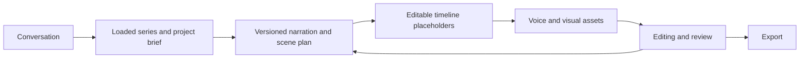

# Product and creator workflow

Status: requirements and proposals · 11 November 2026

## The product

One place for a creator working across YouTube channels, TikTok and Instagram to develop, produce and edit a video. The Director is the conversational entry point. Specialized agents help with creative reasoning; existing editor tools and connectors perform the actual operations.

The desired experience is fast: start with a prompt or microphone input, infer sensible defaults from a selected series, and ask only about missing choices that materially affect the result. Typing must remain available when microphone access or transcription is unavailable.

## Three examples we must accommodate

| Example | Story/audio | Visual production |
| --- | --- | --- |
| Popy episode | A continuous storyteller narrates the adventure; quoted dialogue may be read by that same narrator | Consistent illustrated animal characters; still images change with the story, with restrained motion and transitions |
| Educational explainer | Narration explains a topic, potentially around 15 minutes | Stock footage, illustrations, designed graphics, motion slides, or a mixture |
| Doodle / whiteboard video | Background narration | Illustrations appear through a drawing/reveal treatment; camera movement alone does not reproduce a drawing hand |

Character dialogue spoken by separate characters, moving cartoon scenes, generated video and mixed-media projects are also required directions. They do not all have to be implemented in the first release.

The supplied AI explainer was sampled visually, not listened to in this session. The linked doodle YouTube reference could not be inspected; that example currently rests on the creator's description. Do not call its treatment verified.

## Independent project choices

- **Purpose/audience:** story, tutorial, education, promotion or another intent. This is separate from art style.
- **Visual style:** stickman, hand-drawn, 2D illustration, clay-like 3D, or a saved/custom style.
- **Media treatment:** still images, generated motion clips, stock, uploaded media, HTML motion graphics, or mixed.
- **Movement:** pan/zoom/focus, layered animation, drawing reveal, character motion, or intentional stillness.
- **Audio:** narrator, character dialogue, both, or neither; music/SFX are separate choices.
- **Delivery:** approximate duration, aspect ratio, language and platform.

Set defaults at project level and allow scene overrides. Do not force an illustrated project to generate expensive motion clips for every scene. Model capabilities, clip limits and costs must be checked for the selected route rather than assuming a universal 15-second limit.

## The conversation in practice

**Creator:** “Let's do another Popy episode, this time about sharing.”

**Director:** Shows loaded series context: characters, visual references, narrator choice if actually saved, style, continuity and caption treatment. It asks for the target length only if no useful default exists. The creator can edit the inferred settings directly.

**Creator:** Develops the idea with the Director. Existing narration or artwork can be supplied at any time.

**Directing specialist:** Returns a versioned production draft: story, clean narration, any separate dialogue, proposed scene count, estimated timings, and visual directions linked to the spoken passages. The creator can revise the whole draft or one scene.

**Creator:** “Create these scenes.” Timeline placeholders appear, linked to the draft. The scene count comes from story beats and pacing, not a fixed number of prompts.

**Director:** Offers to use the chosen voice extension. If narration already exists, it is reused. Actual audio timing then informs the scene intervals.

**Creator:** Chooses an image provider/model, reviews the prompts and generates selected or all missing illustrations. A contact sheet allows quick review. Rejected scenes can be regenerated individually without losing accepted work.

**Editing specialist:** Reviews the current cut and proposes music, SFX, subtitles, transitions and image motion. Manual changes are first-class input to subsequent agent work.

**Creator:** Reviews and exports. Packaging and publishing integrations are later additions; exporting a file must work independently.

These are internal states with direct access, not a sequence of blocking forms. The creator may arrive with a script, a voice track, finished images or a rough cut and start from there.

## What success feels like

The creator can see what the agent understood, what is on the timeline, which scenes need work, what a proposed action changes, and what it will cost. They can stop the agent, continue manually, and return later without rebuilding context or regenerating accepted assets.

## Scope boundary

The first implementation should prove one complete illustrated-story workflow in Classic. A public SaaS product, automatic social posting, every art style, arbitrary feature coding and multiple render engines are not prerequisites for that proof. These remain recorded directions rather than hidden extra scope.
