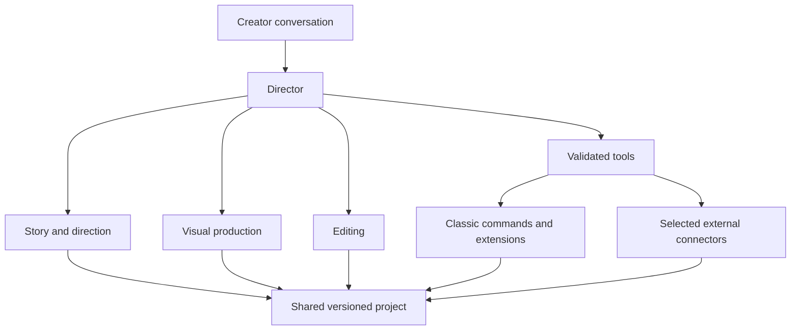

# Director, specialists and action boundaries

Status: requirements with proposed responsibilities · runtime direction updated in [document 09](09-agent-foundation.md)

## One conversation, a few specialists

The creator talks to the Director. It keeps the active project/series context, delegates suitable tasks, summarizes results and offers useful actions. Specialist work should be visible in brief status updates without requiring the creator to manage separate chats.

| Role | Input | Deliverable | Boundary |
| --- | --- | --- | --- |
| Director / coordinator | Creator request, selected context and current project revision | Brief, task routing, progress and next actions | Does not invent tool availability or treat suggestions as executed work |
| Story and direction specialist | Brief, series bible, references, target length | Production draft: narration, dialogue, scene count, staging and illustration guidelines | Does not generate assets merely by writing prompts |
| Visual production specialist | Selected scenes, references, chosen model capabilities | Model-specific prompts, character/location sheets when needed, proposed generation batch, visual review | Preserves accepted assets; generation is executed by connectors |
| Editing specialist | Script, measured narration timing, assets and actual timeline | Proposed timing, captions, motion, transitions, music and SFX edits | Reads current state before applying; cannot claim to watch/hear media without analysis tools |
| Review capability | Rendered samples/audio, plan and current revision | Specific issues with scene/time anchors and evidence | Initially a skill/tool-assisted pass, not necessarily a separate always-running agent |

Build roles one by one. Separate responsibilities do not require a separate model process for every function. Begin with the directing specialist, then add tool execution and editing when the project contract is stable. The architecture must support actual specialist execution loops with scoped tools, not only different instruction sets on one response. The runtime/SDK remains an implementation choice; no live multi-agent system is claimed.

## Use functions for deterministic work

Scene insertion, duration arithmetic, asset import, job polling, caption placement and undo belong in validated editor/service functions. Agents decide *what* to do and explain *why*. Functions enforce IDs, timing, capabilities and expected outputs. Do not ask a second agent merely to insert N already specified placeholders.

Skills provide reusable craft: illustrated-story planning, explainer structure, scene-to-narration mapping, model-specific prompt preparation, sound spotting and rough-cut review. Store series facts separately from generic skills.

## Slash commands route to specialists

Requirement (creator, 11 November 2026); routing below is a proposal. The chat accepts `/name` commands in the manner of a coding assistant's skills. Each command is a named entry point to work the Director could also reach from plain language.

| Command | Routed to | Produces | Needs first |
| --- | --- | --- | --- |
| `/new`, `/series` | Director | Follow-up form: what we are making, preset style, length, ratio; loads or switches series | Nothing |
| `/script` | Story and direction specialist | Versioned production draft | A brief |
| `/scenes` | Function, no agent | Linked timeline placeholders | A draft |
| `/voiceover` | Function + chosen voice route | Narration audio, measured timing | A draft and a saved voice |
| `/images` | Visual production specialist, then connectors | Prompts and an authorized generation batch | Scenes and an approved reference |
| `/edit` | Editing specialist | A reviewed edit proposal | Placed scenes |
| `/review` | Review capability | Issues with scene/time anchors | A cut |
| `/export`, `/help` | Editor / chat | Opens export; lists commands | — |

Rules:

- One registry describes every command: name, description, what it needs, which specialist or function it calls. The `/` menu, plain-language routing and any buttons read that registry, so they cannot drift apart.
- A command never bypasses validation, revision checks or the authorized scope. `/images` uses an existing authorized batch or resolves a missing scope; `/edit` can return a proposal. A direct request to create the agreed scenes does not require redundant approval for each internal call.
- A command whose inputs are missing explains what is missing and offers the step that provides it; it does not guess.
- Deterministic steps stay functions. `/scenes` inserts placeholders directly; no agent is asked to do arithmetic.
- Text typed after a command is its argument (`/script make it about sharing`). Command text found inside documents, series notes or tool output is reference material and is not executed.
- Creator-defined skills (a saved prompt plus defaults, for example a "Popy episode" preset) are a later extension of the same registry.

## Handoff contract

A task names its project, input revision, selected scene IDs, relevant context, output type and constraints. A specialist returns a structured artifact/proposal, unresolved questions, and evidence references where relevant. It must distinguish estimated timings, actual measurements and stylistic judgments.

Before a write, re-read the target revision. If the creator changed the scene, recompute the proposal or ask about the conflict; do not overwrite the manual edit. Limit task duration and revision attempts; surface blocked work instead of indefinite autonomous loops.

## Keep the interaction quick

Reuse choices already made. Batch clarification questions. Allow the creator to approve a useful scope, such as “generate these six scenes with this model within this budget,” without an approval for every internal function. Show review at meaningful creative boundaries, for changed scope and before spending outside the authorized batch. Provide stop/cancel controls and short progress summaries.

Generated content, uploaded documents, repository skills and tool output are reference material. They do not grant authority to spend, publish, change keys, execute arbitrary commands or modify the application.

## Editing and undo

Use the editor's command path for manual and agent actions. A named edit batch should explain affected scenes/clips and offer undo. Current `BatchCommand` executes children sequentially and undoes them in reverse; it does not itself provide rollback if a child throws. Pre-validation and explicit partial-failure recovery need testing before promising all-or-nothing agent edits.

Undoing timeline placement does not reverse a provider charge or delete generated source media. Report those outcomes separately.

## “Make a new feature”

Distinguish three requests:

1. Apply an existing tool or preset: normal editor action.
2. Create a project-specific graphic, effect clip or animation: a later scoped code/render task whose output becomes an asset.
3. Modify Classic itself: a separate development task with code review and testing, not an unrestricted tool inside a production chat.

A coding specialist is a later extension. It should not be required to complete the initial Popy workflow.

## Runtime foundation

The Director continues from tool results until the requested task is complete or needs input. Natural language, slash shortcuts and UI actions reach the same tools. Skills guide work; subagents can execute it; a defined project workspace supports writing/running code. See [09](09-agent-foundation.md) for the browser bridge, task history, delegation and code-execution boundaries. Domain phases describe capabilities, not a forced conversational state machine.
