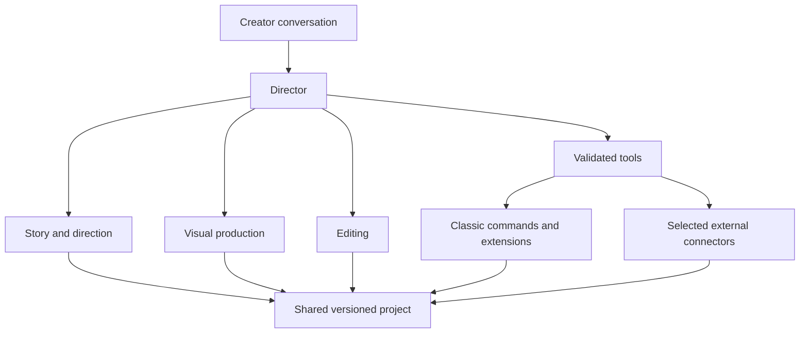

# Director, specialists and action boundaries

Status: requirements with proposed responsibilities

## One conversation, a few specialists

The creator talks to the Director. It keeps the active project/series context, delegates suitable tasks, summarizes results and offers useful actions. Specialist work should be visible in brief status updates without requiring the creator to manage separate chats.

| Role | Input | Deliverable | Boundary |
| --- | --- | --- | --- |
| Director / coordinator | Creator request, selected context and current project revision | Brief, task routing, progress and next actions | Does not invent tool availability or treat suggestions as executed work |
| Story and direction specialist | Brief, series bible, references, target length | Production draft: narration, dialogue, scene count, staging and illustration guidelines | Does not generate assets merely by writing prompts |
| Visual production specialist | Selected scenes, references, chosen model capabilities | Model-specific prompts, character/location sheets when needed, proposed generation batch, visual review | Preserves accepted assets; generation is executed by connectors |
| Editing specialist | Script, measured narration timing, assets and actual timeline | Proposed timing, captions, motion, transitions, music and SFX edits | Reads current state before applying; cannot claim to watch/hear media without analysis tools |
| Review capability | Rendered samples/audio, plan and current revision | Specific issues with scene/time anchors and evidence | Initially a skill/tool-assisted pass, not necessarily a separate always-running agent |

Build roles one by one. Separate responsibilities do not require a separate model process for every function. Begin with the directing specialist, then add tool execution and editing when the project contract is stable. Exact delegation runtime remains an implementation choice; the earlier research plan's AI SDK direction is not an implemented multi-agent system.

## Use functions for deterministic work

Scene insertion, duration arithmetic, asset import, job polling, caption placement and undo belong in validated editor/service functions. Agents decide *what* to do and explain *why*. Functions enforce IDs, timing, capabilities and expected outputs. Do not ask a second agent merely to insert N already specified placeholders.

Skills provide reusable craft: illustrated-story planning, explainer structure, scene-to-narration mapping, model-specific prompt preparation, sound spotting and rough-cut review. Store series facts separately from generic skills.

## Handoff contract

A task names its project, input revision, selected scene IDs, relevant context, output type and constraints. A specialist returns a structured artifact/proposal, unresolved questions, and evidence references where relevant. It must distinguish estimated timings, actual measurements and stylistic judgments.

Before a write, re-read the target revision. If the creator changed the scene, recompute the proposal or ask about the conflict; do not overwrite the manual edit. Limit task duration and revision attempts; surface blocked work instead of indefinite autonomous loops.

## Keep the interaction quick

Reuse choices already made. Batch clarification questions. Allow the creator to approve a useful scope, such as “generate these six scenes with this model within this budget,” without an approval for every internal function. Show review at meaningful creative boundaries, for changed scope and before spending outside the authorized batch. Provide stop/cancel controls and short progress summaries.

Generated content, uploaded documents, repository skills and tool output are reference material. They do not grant authority to spend, publish, change keys, execute arbitrary commands or modify the application.

## Editing and undo

Use the editor's command path for manual and agent actions. A named edit batch should explain affected scenes/clips and offer undo. Current `BatchCommand` executes children sequentially and undoes them in reverse; it does not itself provide rollback if a child throws. Pre-validation and explicit partial-failure recovery need testing before promising all-or-nothing agent edits.

Undoing timeline placement does not reverse a provider charge or delete generated source media. Report those outcomes separately.

## “Make a new feature”

Distinguish three requests:

1. Apply an existing tool or preset: normal editor action.
2. Create a project-specific graphic, effect clip or animation: a later scoped code/render task whose output becomes an asset.
3. Modify Classic itself: a separate development task with code review and testing, not an unrestricted tool inside a production chat.

A coding specialist is a later extension. It should not be required to complete the initial Popy workflow.
