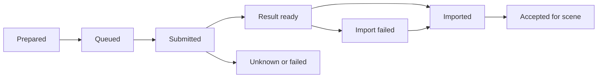

# Series context, scenes, narration and assets

Status: proposed project contract, not a database migration

## Saved context

| Record | Stores | Does not automatically do |
| --- | --- | --- |
| Channel | Audience, purpose, tone, formats and guidelines | Expose all channel history to every request |
| Series | World, cast, continuity, episode list, defaults and accepted references | Force one length or a fixed scene count forever |
| Brand Kit | Colours, fonts, captions, preferred voices/music, character/style references | Silently overwrite an episode's accepted choices |
| Style preset | Art direction and compatible movement/text defaults | Lock every project to a provider or genre |
| Project template | Reusable starting structure and optional intro/outro | Copy another episode's story as the new one |
| Episode/project | Current brief, script revisions, scene plan, assets, timeline and decisions | Write every transient chat message into permanent series memory |

Show the active context and its source. Support editing/removal and per-project overrides. Proposed precedence: explicit project choice → selected series/kit default → visible fallback. Ask when multiple saved records match “Popy.” Keep channels isolated unless the creator explicitly selects shared resources.

## Popy as a real starting point

The supplied `POPy/Skill/popy-series.skill` archive contains a character/world bible, recurring cast, continuity and narration rules. It is useful source material, not instructions to execute in this planning task. Its current five-illustration output and 4–6 minute length should become editable defaults/reference history rather than universal production limits.

The document describes a panda; one inspected illustration depicts a red-panda-like character. Confirm the canonical character and approved reference image before treating either as the series identity. A specific saved narrator provider/voice profile has not been established by this review; do not fill that gap with an invented voice.

The creator's existing files remain in their current location. Import/link strategy and project backup are decisions to test, not reasons to move all media now.

## Production draft / script version zero

Keep story and spoken text separate from technical directions. Each draft contains:

- Brief: topic, audience, intent, target duration, language, ratio and selected series/kit.
- Narrative: story arc and continuous clean narrator script; separate dialogue tracks if used.
- Scene plan: stable scene IDs, order, linked narration passages, visual action, setting, characters, estimated duration and media treatment.
- Production notes: character/location references, continuity, desired movement, caption/sound ideas and missing materials.

The narrator input must never include visual instructions by accident. Quoted dialogue read by a storyteller differs from separately voiced characters; record which audio mode is intended.

## A scene record, in plain language

| Field | Purpose |
| --- | --- |
| Stable ID and revision | Preserve references when scenes move or names change |
| Narration segment IDs / text spans | Tie the picture to the exact spoken passage |
| Estimated and measured timing | Distinguish planning from actual audio alignment |
| Visual description | What viewers should see and why it fits this passage |
| Character/location references | Reuse canonical design and continuity |
| Media type, style and motion | Allow a still image here and a motion clip elsewhere |
| Prompt versions and selected provider/model | Reproduce or revise a specific request |
| Candidate asset IDs and accepted take | Compare/regenerate without losing accepted artwork |
| Timeline element IDs | Link planning cards to the editable cut |
| Status and dependencies | Explain missing, generating, imported, accepted or stale work |

This is a conceptual contract. Use existing project/storage types where possible when implementation starts; do not build a parallel editor database merely to match this table.

## Storyboard scene versus Classic scene

The creator's “scene” is a story beat/shot with a place in the finished video. Classic also has a `TScene` container with its own tracks, and `CreateSceneCommand` adds such a container. They must not be equated without checking sequencing/export semantics.

Initial proposal: represent story scenes as linked cards and timeline intervals/placeholders within the main edit. Explore the visual representation in HTML, then prove insertion, playback and export in Classic. Do not mechanically create N separate Classic scenes and assume they form one continuous video.

## Timing and revisions

1. Start with a plausible duration estimate per spoken passage; no fixed ten-second rule.
2. Reuse or generate the narration; measure returned audio.
3. Obtain alignment suitable for the chosen narration/voice route and check representative words and scene boundaries.
4. Map scene intervals and captions to that audio. A single scene may cover multiple sentences; one sentence may justify multiple shots.
5. Preserve deliberate pauses and transitions. Never stretch speech automatically just to meet an estimate.

For long narration, current local Voice Studio UI text limits mean chunking/assembly needs a trial. Prefer chapter or coherent passage boundaries, retain one voice identity and verify seams; continuous recording versus chunks remains open.

Changing script text can invalidate voice, timings, captions and related images/prompts. Changing an image alone should preserve narration/timing unless requested otherwise. Mark dependent work stale and offer targeted updates. Freeze the selected series/kit revision for an episode so later kit changes do not unexpectedly restyle it.

## Generation job and asset lifecycle

A job records its destination project/scene revision, provider/model, authorized configuration, input/reference hashes, provider job ID if returned, cost estimate, actual reported usage, output and import status.

Persist completion before timeline placement. A job finishing after project switching must retain its original destination and not insert into whichever scene is now active. Duplicate completion must not duplicate assets. A failed import retries the existing result; an uncertain submission is reconciled before a new paid job. Preserve source files and accepted alternatives. Batch cancellation does not imply an already running provider job was cancelled or refunded.

Project/series export and recoverable backup are required design topics: browser storage alone must not be presented as a durable backup.
