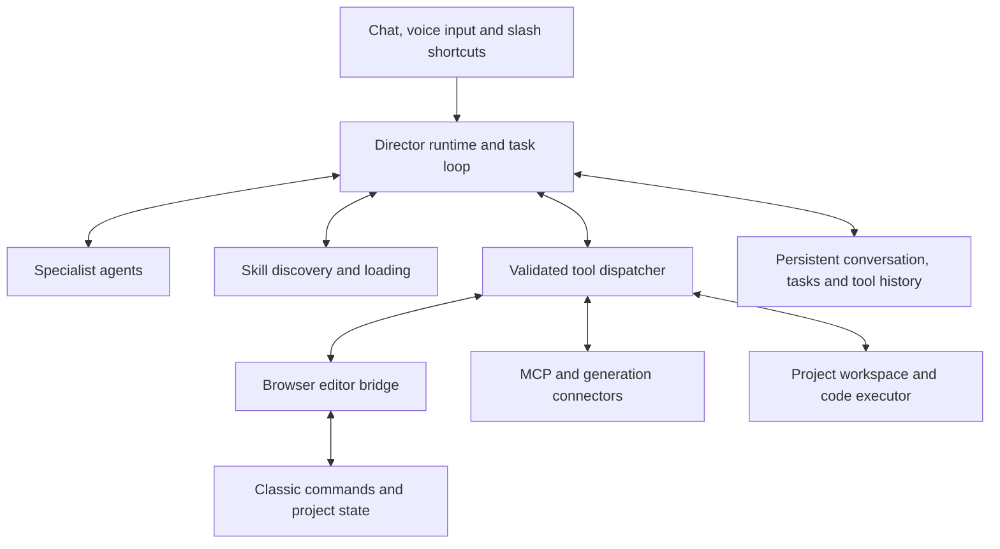

# Agent foundation and the happy-path prototype

Current architecture direction · 11 November 2026 · `director-agents-phases`

## Product decision

The Director is a conversational, tool-using editor agent. It reads context, chooses operations, runs tools, observes their results and continues a task. It can load skills, delegate to specialist agents, use MCP services, and write/run code in a defined project workspace. Slash commands and presets are optional entry points to the same runtime, not the limits of what it can do.

This replaces document 08's assumption that specialists are only instruction/schema modes on a single request/response route. Its production schemas and deterministic operations remain useful. The runtime framework, transport and exact execution mechanism are not selected by this document.

We are refining the HTML and this plan together before implementing the runtime. The HTML is an interaction experiment, not evidence that agent execution or generation works.

## Happy path to design now

1. Open chat from the floating icon in the preview. No modal opens on project load.
2. Describe an episode, for example “Make a Popy story about sharing.” Receive a conversational reply using visible demo defaults; an inline settings form is optional.
3. Ask for the story and visuals. A directing specialist returns clean narration beside six example scene directions. Six is a demo count, never a production rule.
4. Say “I'm happy with the story. Create the scenes.” The agent reads the draft/timeline, places linked placeholders, checks the result and reports completion without another setup screen.
5. Ask for narration. The voice extension returns audio; the real implementation measures it and aligns scene passages. The prototype displays simulated timing only.
6. Ask for illustrations. A visual specialist prepares prompts; the selected connector returns results bound to those scenes. Review or regenerate a single candidate without replacing accepted neighbours.
7. Ask for an editing pass. Review caption, camera-motion and sound changes; apply and undo the batch.
8. Review coverage and delivery readiness. Mock export explains that no real video is rendered.

The HTML uses fixed intent matching and scripted activity/results. Coloured cards are visual stand-ins, the narrator is explicitly fictional, and no text/audio/images are sent to a provider. The default demonstration succeeds; failure exploration is optional.

## Initial providers and MCP

OpenAI and Anthropic APIs power Director reasoning/tool use. OpenArt MCP is the primary image/video generation connection and belongs in the connector foundation. Additional MCPs remain possible; Grok/xAI is optional later. Narration retains the creator-selected voice extension. See [document 10](10-openart-and-model-providers.md). Model access and operations are discovered/verified, not assumed.

## Runtime architecture

The browser owns the live editor. A runtime outside the browser owns model calls, local services and code execution. It must not assume server code can directly invoke an in-browser singleton. Transport (streamed requests/results, local bidirectional connection or another mechanism) needs a focused trial.

## Foundation capabilities

### The continuing task loop

A user turn may contain several model/tool cycles. Each cycle provides available tool descriptions and relevant context, validates the selected calls, executes within the authorized scope, stores results and returns observations to the model. The loop ends on completion, a real need for creator input, cancellation, a fault requiring attention or a configured resource limit.

Persist task ID, project ID, conversation/tool messages, stage/status and pending operations. Stream useful progress without exposing hidden reasoning. Acknowledging a request is not evidence the requested operation happened.

### Editor tools and the browser bridge

Start with a small set of read, create-placeholder, inspect-placement and undo operations over the existing command path. Tool requests carry invocation ID, project identity and relevant expected revision; results carry success/failure and actual created/updated IDs. Replayed requests must not duplicate edits.

Capture the relevant timeline state as well as draft revisions. A creator can move a clip without changing narration or draft version. Recheck before applying, then report an explicit conflict instead of overwriting their edit.

Safe independent reads can run together; mutations to the same edit are ordered. Reuse commands, media processing and storage; do not create a second timeline implementation.

### Skills and slash commands

A tool performs an operation. A skill supplies craft instructions and resources for achieving an outcome. `/script` loads or requests a workflow; plain language can reach the same workflow without a command. The model may discover/load a skill when appropriate. A registry supports discovery and UI shortcuts but is not an exhaustive natural-language intent table.

### Actual subagents

A delegated specialist has a task ID, role instructions, scoped project context, available tools, its own execution loop, progress and a completion result. It can call tools rather than only return a differently shaped text response. Define delegation depth, cancellation, costs and shared-state write ownership. Begin with one direction specialist; add others incrementally.

### Code execution

Code tools can read/write project files, execute supported scripts, inspect outputs and import accepted artifacts. Record generated code and execution results so work is reviewable and resumable. The workspace and available runtimes must be defined before enabling this capability.

Project scripts, custom animations and reusable project tools belong in this capability. Changes to Classic's application source are a separately scoped development task. A model cannot obtain arbitrary execution authority merely by writing a skill or reading imported material.

### Authority without constant interruptions

“Create the scenes from this draft” authorizes that edit and the necessary internal reads/checks; do not ask again for each function. Paid generation requires a selected route and authorized batch/cost scope. Reuse existing authorization within its bounds, stop for changed scope, and preserve accepted work. Undoing placement cannot refund a provider job.

## Revised build order

| Phase | Deliverable | Proof |
| --- | --- | --- |
| Design now | HTML happy path plus synchronized plans | Creator walks the experience and requests adjustments |
| F1 | Minimal continuing agent loop and tool messages | One natural-language request uses a read tool and continues from the actual result; mocks in automated tests |
| F2 | Browser bridge and first edit task | Read draft → create linked placeholders → inspect timeline → completion; one undo; duplicate request and stale target tests |
| F3 | Persistent tasks and cancellation | Reload/disconnect does not duplicate an edit or restart a paid action; stopped tasks retain accurate history |
| F4 | Skills and one real specialist | A direction task runs in a child loop, uses scoped tools and returns a draft to the Director |
| F5 | Project coding capability | Write/run a small project artifact, inspect output and import it through the normal media route |
| Production expansion | Voice, OpenArt image/video generation, editing and additional MCP routes | Add document 08's relevant tasks behind this same runtime, one complete loop at a time |

Choose the runtime/SDK through a small tool-call + browser-bridge trial, not by copying a full coding CLI. The inspected local OpenClaude/claude-o trees illustrate patterns; they are not installed dependencies. OpenClaude's local LICENSE contains an explicit proprietary-derived-source notice, so copying source is not assumed permitted.

## What changes in document 08

- Keep the implemented contract/draft operations (Tasks 5–6), while recording actual status.
- Retain proposed persistence, scene insertion, narration, job and edit operations as reusable domain work.
- Replace Tasks 9/24's fixed-mode-only runtime assumption with the continuing loop and specialist handoff above.
- Route slash commands and ordinary conversation through the same tools/skills; do not require users to translate their request into a command.
- Scope pending edit checks to current timeline state, not only `draftVersion`.
- A measured audio-chunk duration divided by text length yields estimated inner boundaries; reserve measured/aligned scene claims for evidence at that level.
- Keep full-length generation, provider access, code execution and subagent reliability unverified until their trials pass.

No production runtime implementation or provider calls are authorized by this document alone. The current work is HTML design and planning; no commits are part of this iteration.

## Chat-first correction · 11 November 2026

The agent always opens as a conversation with a visible message composer. A first idea receives a conversational reply, not an automatic brief form. Forms/settings appear inline only when requested or when missing information needs a specific structured choice. Suggested messages and presets are optional aids. The message input stays visible as the conversation grows. The current HTML uses this corrected interaction.
