# OpenArt MCP and model-provider choices

Creator decision · 11 November 2026 · planning only

## Provider split

| Responsibility | Initial route | Decision |
| --- | --- | --- |
| Director reasoning and tool use | OpenAI or Anthropic APIs | Both are in the initial scope; the creator already has API access. Choose a configured model capable of the required tool loop |
| Specialist reasoning | OpenAI / Anthropic through the same runtime | Start with the selected Director model; allow a configured specialist override without adding another provider requirement |
| Image generation | OpenArt MCP | Primary media-generation route, replacing the earlier direct-Gemini-first plan |
| Video generation | OpenArt MCP | Primary route when a scene calls for generated motion; images plus editor motion remain valid and often sufficient |
| Image editing | OpenArt MCP when the connected account exposes a suitable operation | Discover/verify source-image, mask/reference and instruction support before offering the operation |
| Narration / voiceover | Existing voice extensions, with the creator's selected voice | This decision does not move TTS to OpenArt or select a voice automatically |
| Grok / xAI | Optional later | The creator has a key, but this is not needed for the initial foundation; existing code need not be removed |

OpenArt is selected for access to a broad model choice. This plan does not claim that every image/video model exists in its MCP catalogue, is exposed to this account, or supports every operation. Resolve those facts from the connected service before execution. Do not hardcode a universal clip-length limit or rely on past model names/prices.

## MCP is part of the foundation

The agent runtime has a connector/tool registry that can include multiple MCP servers. OpenArt is the first planned media MCP integration, not a separate assistant and not a later optional replacement for the initial image route. The Director discovers the available operations and calls them through the same validated dispatcher used for editor tools.

Other MCPs can be added when a real workflow needs them. None is required merely to make the registry extensible. Expose descriptions and schemas on demand so a large catalogue does not flood every model request.

## Planned connection experience

1. Show OpenArt in Connections with disconnected, connecting, connected and reconnect-needed states.
2. Reuse the existing local OAuth/tool-discovery foundation where appropriate; verify its lifecycle against the new task runtime rather than assuming current sessions are durable.
3. After connection, discover actual tool schemas, models and relevant input capabilities through whatever operations the service advertises.
4. Let the creator choose the image/video model for a project or batch, with scene-specific overrides when useful. Remember the choice without silently switching it.
5. Show provider/model and selected reference scope in the generation request, along with an estimate when the service supplies one. Unknown cost remains visibly unknown.

No account connection, API-key handling or provider generation is performed by this planning update. A key's existence is not proof of quota, model access or a successful tool call.

## One generation loop

```mermaid
flowchart LR
  A[Creator request or skill] --> B[Director / visual specialist]
  B --> C[Scene prompts and selected OpenArt model]
  C --> D[Authorized batch through MCP]
  D --> E[Persist job identifiers and status]
  E --> F[Fetch result and import into original project]
  F --> G[Review candidates and accept onto timeline]
  G --> H[Director verifies placement and continues]
```

The visual specialist adapts prompts to the chosen model and treatment, using selected character/style/location references. It does not upload every asset in a series automatically. Keep the clean narration separate from generation instructions.

A batch records project ID, scene IDs/revisions, selected model/configuration, prompt/reference versions, authorized count/budget scope and provider job ID if returned. Results retain those destinations when the creator changes projects. Import through Classic's existing media pipeline; do not insert blindly at the current playhead.

Reconcile uncertain submissions before another paid call. Retry a download/import from an existing result without regenerating. Preserve accepted alternatives. Cancelling queued work does not imply the provider cancelled or refunded already submitted work.

## First implementation trials, after the HTML design

| Trial | Pass condition |
| --- | --- |
| Director provider loop | Both configured OpenAI and Anthropic routes complete a read-tool/result/continuation cycle; differences are handled by adapters |
| OpenArt discovery | UI reports the connected account's observed operations and can distinguish generation from editing |
| One image scene | Chosen model and references produce a result, saved to the intended project and offered as a candidate |
| One motion scene | Supported duration/ratio are selected from observed capability; returned video can be imported and placed |
| Reopen and recovery | A pending/completed job can be reconciled without a duplicate submission |
| One image replacement | Regeneration or supported editing changes only the selected scene; narration/timing and neighbouring accepted takes survive |

Use mocked tools in automated tests. Live generation trials require their selected configuration and authorized cost scope. Do not run every trial merely because it is listed.

## Relationship to older work

Existing Gemini image/TTS extensions remain available as manually usable or optional alternate routes. Their code is not removed. Document 08 Task 20's direct-Gemini batch implementation is superseded for the initial agent image path and must be rewritten around OpenArt discovery and asynchronous jobs before execution. Its scene binding, candidate review and no-duplicate requirements remain applicable.

Exact SDK, model IDs, catalogue tools, pricing, credit availability and runtime compatibility remain unverified implementation inputs. OpenAI/Anthropic API credentials and OpenArt account authorization are separate connections and must not be conflated.
